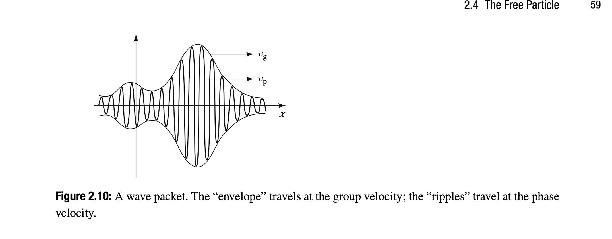

Griffith 71: You can only have discontinuity in the first derivative of the wave function when the potential goes to infinity. If the potential just changes like in the case of a finite well then you cant have a discontinuity. You can show such a thing by solving the TISE w a small epsilon and taking the limit.
Because otherwise $\psi$ wouldn't solve the Schrödinger equation at the boundary. It's not an extra rule; it's forced by the equation.

The TISE says:

$$\psi'' = \frac{2m}{\hbar^2}\,(V - E)\,\psi$$

At a boundary like $x = a$ in the finite well, $V$ jumps from $-V_0$ to $0$, but it stays finite. So the right side is finite, which means $\psi''$ is finite there.

If $\psi'$ jumped at $x = a$, the slope would change by a finite amount over zero distance. That requires an infinite $\psi''$ at that point, a delta-function spike. The right side has no spike to match it, so the equation would fail at $x = a$. A kinked $\psi$ at a finite step isn't a solution.

- A stationary state (As we define in probability and in MLCS to be a state at which the probabilitiy distribution does not change over time) is a solution of the Schrödinger equation with one **definite** energy, i.e. a separable solution

$$\Psi(x,t) = \psi(x)\,e^{-iEt/\hbar}.$$

It is called stationary because the probability density does not change in time, the time factor is a pure phase, so $|\Psi(x,t)|^2 = |\psi(x)|^2$. Clearly, if the Energy is different or changing, this would not be the case.

- If k is the wave number, what is kappa when we do that derivation that involves tan and arctan

- To find the quantum mechanical speed of a wavefunciton you divide the coefficient of t by the coefficient of x

- Why is it that for wave packets we require a fourier transform of a way that is contineous rather than discrete, whydoes a series not work

- Understood how the Phi(k) is the contineous version of c_k in the case of integral summation

- And so we basically have a phase velocity and a group velocity where the phase velocity is that of the individual ripples of the wave functions correspoinding to $\Psi$ but also there is some sort of an envelope velocty which is twice as fast in this particular case of quantum mechanical wave functions, that group velocity corresponds to the classical velocity of the particle. For the example of a string we get the group and the phase velocity the same and for the case of watre wave its alf of the phase velocity.

- What is a dispersion relation and what does it have to do with w in QM.

-